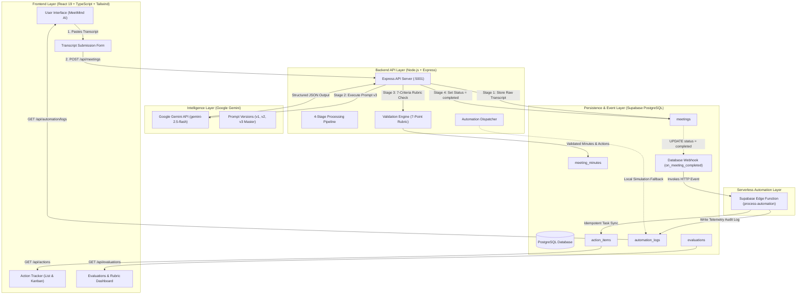

# MeetMind AI: System Architecture & Workflow Diagram

## 1. High-Level Architecture Diagram



---

## 2. 4-Stage Processing Pipeline Breakdown

The application guarantees that every transcript passes through four deterministic processing stages with real backend state progression:

```
┌─────────────────────────┐
│ Stage 1: Ingestion      │ -> Validate input, assign UUID, store raw transcript in Supabase
└────────────┬────────────┘
             │
┌────────────▼────────────┐
│ Stage 2: AI Extraction  │ -> Prompt Google Gemini (Prompt v3 Master), extract decisions, tasks, citations
└────────────┬────────────┘
             │
┌────────────▼────────────┐
│ Stage 3: Validation     │ -> Verify schema, enforce zero-hallucination rules, run 7-criteria evaluation
└────────────┬────────────┘
             │
┌────────────▼────────────┐
│ Stage 4: Automation     │ -> Save minutes, mark status 'completed', trigger Webhook -> Edge Function -> Action Tracker
└─────────────────────────┘
```

---

## 3. 3-Minute College Demonstration Walkthrough

When presenting MeetMind AI to professors or examiners:

1. **Step 1: The Problem (30 seconds)**
   - Show how unorganized meeting notes lead to forgotten tasks and confused responsibilities.
   - Introduce MeetMind AI: an automated system that extracts confirmed decisions, action items, owners, and deadlines.

2. **Step 2: Processing a Transcript (60 seconds)**
   - Navigate to **"New Meeting"**.
   - Click the 1-click test case button: **"TC-01: Normal Meeting"** or **"TC-05: Ambiguous Edge Case"**.
   - Click **"Run Intelligent Extraction"**.
   - Show the **Processing Pipeline Stepper** dynamically advancing through all 4 stages.

3. **Step 3: Audit-Ready Results & Human Review (45 seconds)**
   - Show the generated **Executive Summary**, **Key Discussion Points**, and **Ratified Decisions**.
   - Highlight the extracted **Action Items**: point out the verbatim quotes in the **"Ref Evidence"** row.
   - Show how missing owners or dates are safely flagged as **"Unassigned"** or **"No Deadline"** rather than hallucinated.
   - Click **"Edit Summary (Human Review)"** to demonstrate human-in-the-loop corrections.

4. **Step 4: Action Tracker & Kanban (30 seconds)**
   - Navigate to **"Action Tracker"**.
   - Switch between **Table View** and **Kanban View**.
   - Drag or toggle a task status to **"Completed"**; note that changes instantly persist in the database.

5. **Step 5: Evaluations & Automation Evidence (35 seconds)**
   - Open **"Evaluations & Rubric"**: show the comparison between **Prompt v1 (57% accuracy)** vs **Prompt v3 (100% accuracy)** across the 5 test cases.
   - Open **"Automation & Logs"**: show the Supabase Database Webhook telemetry proving the Edge Function executed and logged its run in `automation_logs`.
